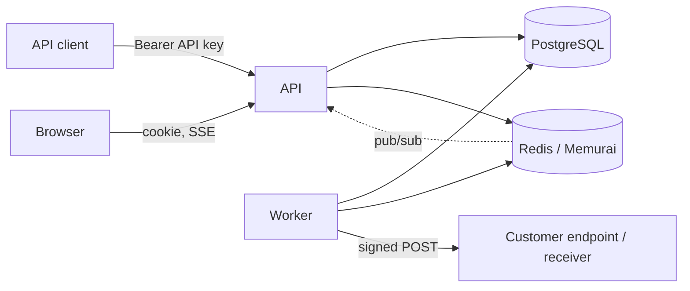
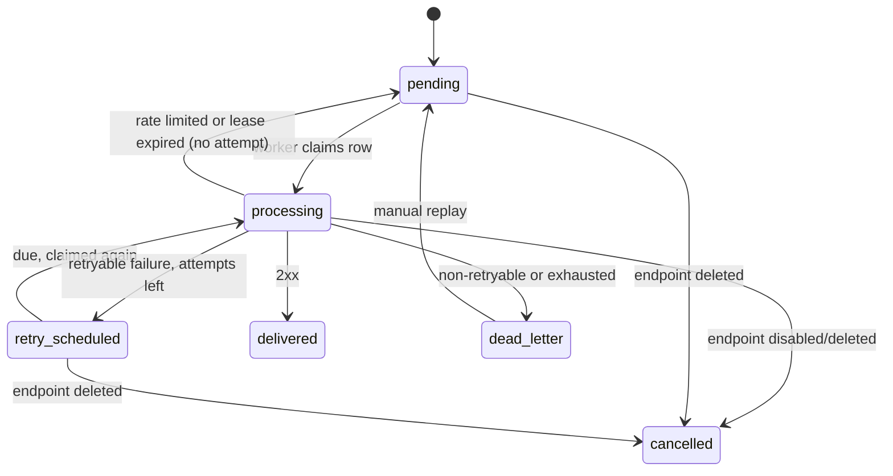

# Architecture

EventMesh is a modular monolith: one Go module, several binaries.

| Process | Role |
| --- | --- |
| `cmd/api` | REST API, auth, ingestion, SSE stream, serves the built frontend, `/docs`, metrics on `EM_METRICS_PORT` |
| `cmd/worker` | Delivery worker pool plus the scheduler, reaper and reconciler loops; metrics on `EM_WORKER_METRICS_PORT` |
| `cmd/receiver` | Local test webhook target that verifies signatures |
| `cmd/migrate`, `cmd/seed`, `cmd/loadtest`, `cmd/redischeck`, `cmd/dbcheck` | Run-once tools |

Handlers (`internal/*/handler.go`) parse and validate; services hold business rules; sqlc-generated code
(`internal/database/db`) talks to PostgreSQL.

## Deployment on one machine

## Ingestion flow

`POST /api/v1/events` -> `apikeys.Handler.RequireKey` -> per-user rate limit -> `events.Handler.Ingest` ->
`events.Service.Ingest`: in **one transaction** insert the event, select matching enabled endpoints, insert one
delivery per endpoint (`insert`). After commit (`afterCommit`) the delivery IDs are pushed to the Redis ready list and a
`event.created` update is published. If enqueueing fails, the error is logged and the request still returns `202`: the
reconciler finds the due rows in PostgreSQL.

## Queue flow

A job is only a delivery ID. Three Redis keys (`<prefix>:queue:ready` list, `:delayed` and `:processing` sorted sets)
are changed only by Lua scripts (`internal/queue/queue.go`): enqueue, schedule, claim, ack, promote, reap. Claim pops
from `ready` and adds to `processing` with a lease expiry in one step, so a job is never in neither place.

## Worker flow

`workers.Pool.Run` starts `EM_WORKER_COUNT` workers fed by one dispatcher over an unbuffered channel; a token channel
means the dispatcher claims a job only when a worker is idle. For each job `Pool.process`:

1. Claim the row (`ClaimDelivery`): `UPDATE ... WHERE status IN ('pending','retry_scheduled') AND next_attempt_at <= now()`.
   No row means stale or duplicate: ack and drop (or reschedule if not yet due).
2. Cancel if the endpoint is disabled or deleted.
3. Take a token from the endpoint's rate limiter; if none, defer to `pending` with a later time (no attempt recorded).
4. Decrypt the secret, build the body, send (`webhook.Client.Send`), classify (`retry.Classify`).
5. `Pool.record`: in one transaction `FinishDelivery` (fenced by `locked_by`) then `InsertAttempt`; after commit ack or
   schedule the retry in Redis and publish `delivery.updated`.

## Delivery lifecycle

The allowed transitions are defined once in `internal/deliveries/state.go` (table-tested), and every `UPDATE` also states
the status it expects.

## Background loops (in the worker process, safe to run in several)

| Loop | Interval | Job |
| --- | --- | --- |
| Scheduler | 500 ms | `PromoteDue`: delayed -> ready |
| Reaper | 10 s | `ReapExpired` in Redis; `ReapExpiredDeliveries` resets `processing` rows past their lease to `pending` and enqueues them |
| Reconciler | 30 s | enqueue rows that are due in PostgreSQL but older than a 30 s grace |

## Live updates

The worker and the API are separate processes, so updates travel through Redis pub/sub (`<prefix>:updates:<user_id>`).
`realtime.Hub` pattern-subscribes once and fans out to per-client bounded buffers; a client that cannot keep up is
dropped (EventSource reconnects). The browser reacts by invalidating TanStack Query keys, never by patching caches.

## Failure handling

See the scenario table in [reliability.md](reliability.md).

## Observability

Structured JSON logs (`log/slog`) go to stdout, which `start-stack.ps1` redirects to `logs\<process>.log`. API logs carry request ID
(also returned as `X-Request-Id` and in error bodies), method, route template, status, duration and user ID; worker logs carry
worker ID, delivery/event/endpoint IDs, attempt, outcome, error category and duration. Bodies, headers, secrets and payloads are never
logged (test-enforced).

Prometheus metrics: API on `http://127.0.0.1:9090/metrics`, worker on `http://127.0.0.1:9091/metrics` (loopback only).
`eventmesh_events_ingested_total{result}`, `eventmesh_delivery_attempts_total{outcome,error_category}`,
`eventmesh_deliveries_completed_total{final_status}`, `eventmesh_delivery_attempt_duration_seconds{outcome}`,
`eventmesh_delivery_latency_seconds`, `eventmesh_queue_depth{queue}`, `eventmesh_workers_busy`,
`eventmesh_rate_limited_total{scope}`, `eventmesh_http_request_duration_seconds{route,method,status}`. No user, endpoint, event or
delivery ID is ever a label value: each distinct value creates a new time series, so IDs would make cardinality unbounded.

Quick check: `(Invoke-WebRequest http://127.0.0.1:9091/metrics -UseBasicParsing).Content -split "`n" | Select-String eventmesh_queue_depth`.
Local Prometheus: a scrape config with `static_configs: [{targets: ['127.0.0.1:9090','127.0.0.1:9091']}]`.

## AI features (milestone 11, optional)

They sit beside the delivery path, never in it: `backend/internal/ai` is imported only by the API router, so workers, the
queue and the retry code cannot call a model, and a provider outage cannot delay or fail a delivery. Everything goes through
one `Service` that checks the feature flag and key first (`feature_disabled` / `ai_not_configured`), truncates input, caps
output, takes a token from a shared limiter, calls the `Provider` interface (Gemini in `gemini.go`, a fake in tests) and
writes an audit row.

**RAG over the docs.** `scripts\index-docs.ps1` chunks `README.md`, `docs/openapi.yaml` and `docs/*.md` (not the build spec, progress log or evaluation reports) by heading (OpenAPI
by path and schema), embeds only chunks whose content hash is new, and stores them in pgvector's `doc_chunks`. A question is
embedded, the 5 nearest chunks by cosine distance are retrieved, and if the best similarity is under the threshold (0.68 by default, chosen from the evaluation) the answer is
"Not found in the docs." without calling the chat model. Otherwise the chunks go into a prompt that says to answer only from
them, and the response cites exactly those chunks. The model is told the excerpts are data, but excerpts are still text the
model reads: a hostile sentence in a doc could influence an answer, which is why the docs are the project's own files.

**Explanations and search.** The explanation of a dead-lettered delivery is a second, labelled block under the
deterministic one. Search asks for a six-field JSON object, validates it strictly, and hands back filters for the user to
confirm; the events page then runs them through the same list function as any manual filter.

**What the numbers do and do not show.** `docs/ai-evaluation.md` reports retrieval recall and latency only after
`scripts\eval-docs.ps1` has run against a real index; until then it says it was not run. It never measures answer quality.
