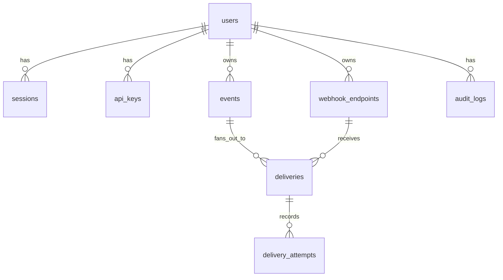

# Database

Schema: `backend/migrations/000001_init.up.sql` (with a working `.down.sql`; the integration harness migrates up, and
`scripts\migrate.ps1`, `-Down`, then again was run). Conventions: UUIDv7 primary keys generated in Go (time-ordered, for
index locality), `timestamptz` everywhere, enum-like columns as `text` with `CHECK`, foreign keys on every reference.

## Constraints worth knowing

- `users.email` is lower-cased and trimmed (`CHECK`), unique.
- `sessions` and `api_keys` store only a SHA-256 hash of the token / key.
- `webhook_endpoints.event_types` must have 1-50 entries; rate limit 1-1000; retry overrides are nullable (null = system default).
- `events.payload` must be a JSON object; unique `(user_id, idempotency_key)` where the key is not null.
- `deliveries` is unique on `(event_id, endpoint_id)` and carries a `CHECK` that the lease columns match the status.
  `user_id` is denormalised on purpose so ownership checks and lists need no join.
- `delivery_attempts` is unique on `(delivery_id, attempt_number)`, append-only, excerpt capped at 2 KB.

## Indexes and the query each serves

| Index | Query |
| --- | --- |
| `events (user_id, created_at DESC, id DESC)` | keyset-paginated event history |
| `events (user_id, event_type, created_at DESC)` | event-type filter |
| `events` unique `(user_id, idempotency_key) WHERE key IS NOT NULL` | idempotency (correctness comes from this constraint) |
| `deliveries (user_id, status, created_at DESC)` | delivery explorer status filter, dashboard counts |
| `deliveries (user_id, created_at DESC, id DESC)` | unfiltered delivery list |
| `deliveries (endpoint_id, created_at DESC)` | endpoint history and statistics |
| `deliveries (next_attempt_at) WHERE status IN ('pending','retry_scheduled')` | reconciler (`ListDueDeliveries`) |
| `deliveries (lease_expires_at) WHERE status = 'processing'` | reaper (`ReapExpiredDeliveries`) |
| unique `delivery_attempts (delivery_id, attempt_number)` | attempt history |
| `audit_logs (user_id, created_at DESC, id DESC)` | activity page |
| `webhook_endpoints (user_id, created_at DESC) WHERE deleted_at IS NULL` | endpoint list and fan-out |
| `sessions (token_hash)`, `api_keys (key_hash)` unique | authentication lookups |

Event detail reads deliveries through the unique `(event_id, endpoint_id)` index.

## Measured query plans

`backend/bench/seed.sql` fills a scratch database with 20 users, 400,000 events and 1,200,000 deliveries (170 MB table);
`backend/bench/plans.sql` runs `EXPLAIN (ANALYZE, BUFFERS)` on three queries, each with and without its index (the index is
dropped inside a transaction that is rolled back). Numbers are from the development machine on 2026-11-16, PostgreSQL 18.7,
warm cache, one run each; they vary run to run, so read the ratios and the plan shapes, not the last digit.
`scripts\explain-plans.ps1` wraps the steps (the steps were run by hand; the wrapper script itself was not run).

| Query | With the index | Without | What the plan shows |
| --- | --- | --- | --- |
| Delivery explorer: one user's `dead_letter` rows, newest 26 | **0.14 ms**, index scan, 30 buffers | **86 ms**, parallel seq scan of all 1.2 M rows, 21,897 buffers, then a top-N sort | The index is ordered `(user_id, status, created_at DESC)`, so the first 26 entries *are* the answer: no sort, no filter |
| Event history, page 600 (after 15,000 rows) | keyset: **0.12 ms**, 13 buffers (page 1: 0.06 ms) | `OFFSET 15000`: **21-57 ms** across three runs, 5,897 buffers | OFFSET reads and sorts all 20,000 of the user's events to throw 15,000 away; keyset seeks straight to the cursor, so page 600 costs the same as page 1 |
| Reconciler: due deliveries (`ListDueDeliveries`) | partial index: **0.48 ms**, 486 buffers | **2.1 ms**, 1,172 buffers | See below: a smaller win than expected |

Things the numbers taught that the design did not predict:

- **The partial index is a modest win here, not a dramatic one.** Without it PostgreSQL 18 did not fall back to a table scan:
  it *skip-scanned* `deliveries (user_id, status, created_at)` (the plan shows `Index Searches: 21`, one probe per user and
  status) and then sorted. With few users that is cheap. The partial index still wins on three counts: it is **16 kB against
  60 MB** because it only holds the roughly 0.1% of rows that are pending, it returns rows already in `next_attempt_at`
  order, and its cost does not grow with the number of users. On an older PostgreSQL (no skip scan) the gap would be larger;
  that was not measured.
- **A sequential scan is only 600x slower, not "seconds", at this size.** 86 ms on 1.2 M rows with two parallel workers. The
  "2 ms versus 2 s" story needs a table around 20-30x bigger, or a cold cache; the first, cold run of the same indexed
  queries read from disk and took several times longer.
- The synthetic data uses PostgreSQL's `uuidv7()` and evenly spread timestamps. Real data is burstier, and the synthetic
  rows are narrower than real payloads, so real scans would be slower than these.

## Transactions and isolation

Ingestion (event + all deliveries), endpoint changes + audit row, replay + audit row, and the worker's
`FinishDelivery` + `InsertAttempt` are each one transaction. Audit rows are written in the same transaction as the
change they describe.

Every transaction runs at PostgreSQL's default isolation level, **READ COMMITTED**; nothing sets a level. That is a
deliberate fit, not an oversight, because no correctness rule here depends on a transaction seeing a stable snapshot
across several statements. Each rule is enforced by a single statement or a constraint:

| Rule | What enforces it | Why READ COMMITTED is enough |
| --- | --- | --- |
| One worker per delivery | `ClaimDelivery`: `UPDATE ... WHERE id = $1 AND status IN ('pending','retry_scheduled')` | The first `UPDATE` takes the row lock. A second one waits, and when the first commits PostgreSQL **re-checks the `WHERE` clause against the new row version**; the status is now `processing`, so it matches zero rows. `TestConcurrentClaimsOfOneDeliveryAdmitExactlyOne` races 32 claims and asserts exactly one wins |
| A stale worker cannot overwrite a newer result | `FinishDelivery ... AND status = 'processing' AND locked_by = $worker` (fencing) | Same mechanism: the predicate is evaluated on the current row |
| One event per idempotency key | Unique index `(user_id, idempotency_key)` + `INSERT ... ON CONFLICT DO NOTHING` | A constraint holds at every isolation level; the loser gets no row back and reads the winner's event |
| One delivery per (event, endpoint) | Unique constraint | As above |
| Reaper batches do not collide | `FOR UPDATE SKIP LOCKED` | Rows locked by another reaper are skipped instead of waited on |

What READ COMMITTED does **not** give, and where it shows: two statements in one transaction can see different data. The
dashboard's three statistics queries run separately, so totals and the chart can disagree by a delivery that finished in
between. That is acceptable for a dashboard and would not be for money. A "check then write" in application code
(`SELECT` the balance, then `UPDATE` it) would be a lost-update bug at this level; the fix is what this code does
everywhere: put the condition in the `UPDATE`'s `WHERE`, or use `SELECT ... FOR UPDATE`, or raise the level to
SERIALIZABLE and retry on serialization failures (not used here: every transaction would need a retry loop).

## Keyset pagination, not OFFSET

Lists use an opaque cursor = base64 of `(created_at, id)` and `WHERE (created_at, id) < ($1, $2) ORDER BY created_at DESC,
id DESC LIMIT n`. `OFFSET n` makes PostgreSQL walk and discard n rows (cost grows with page depth) and shifts results
when rows are inserted while paging; keyset is O(log n) per page via the index and stable.

## Event status is derived

`no_subscribers` (no deliveries), `in_progress` (any non-terminal), `delivered` (all delivered), `failed` (all terminal,
at least one not delivered) are computed in SQL from the event's deliveries instead of stored. Storing it would mean
updating the event row from many concurrent workers and keeping two rows consistent. The cost: list queries aggregate
over deliveries (served by `deliveries (event_id)` via the unique key); for very large fan-out a materialised or
cached status would be the next step.
