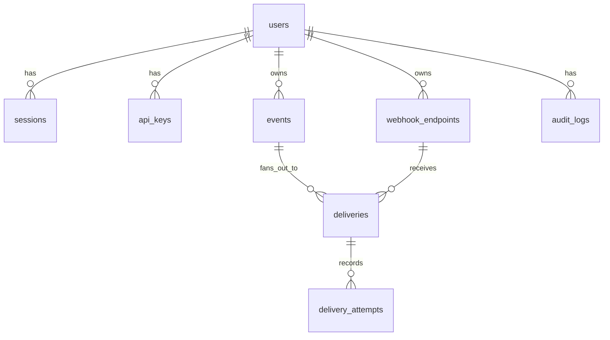

# Database

Schema: `backend/migrations/000001_init.up.sql` (with a working `.down.sql`; the integration harness migrates up, and
`scripts\migrate.ps1`, `-Down`, then again was run). Conventions: UUIDv7 primary keys generated in Go (time-ordered, for
index locality), `timestamptz` everywhere, enum-like columns as `text` with `CHECK`, foreign keys on every reference.

## Constraints worth knowing

- `users.email` is lower-cased and trimmed (`CHECK`), unique.
- `sessions` and `api_keys` store only a SHA-256 hash of the token / key.
- `webhook_endpoints.event_types` must have 1-50 entries; rate limit 1-1000; retry overrides are nullable (null = system default).
- `events.payload` must be a JSON object; unique `(user_id, idempotency_key)` where the key is not null.
- `deliveries` is unique on `(event_id, endpoint_id)` and carries a `CHECK` that the lease columns match the status.
  `user_id` is denormalised on purpose so ownership checks and lists need no join.
- `delivery_attempts` is unique on `(delivery_id, attempt_number)`, append-only, excerpt capped at 2 KB.

## Indexes and the query each serves

| Index | Query |
| --- | --- |
| `events (user_id, created_at DESC, id DESC)` | keyset-paginated event history |
| `events (user_id, event_type, created_at DESC)` | event-type filter |
| `events` unique `(user_id, idempotency_key) WHERE key IS NOT NULL` | idempotency (correctness comes from this constraint) |
| `deliveries (user_id, status, created_at DESC)` | delivery explorer status filter, dashboard counts |
| `deliveries (user_id, created_at DESC, id DESC)` | unfiltered delivery list |
| `deliveries (endpoint_id, created_at DESC)` | endpoint history and statistics |
| `deliveries (next_attempt_at) WHERE status IN ('pending','retry_scheduled')` | reconciler (`ListDueDeliveries`) |
| `deliveries (lease_expires_at) WHERE status = 'processing'` | reaper (`ReapExpiredDeliveries`) |
| unique `delivery_attempts (delivery_id, attempt_number)` | attempt history |
| `audit_logs (user_id, created_at DESC, id DESC)` | activity page |
| `webhook_endpoints (user_id, created_at DESC) WHERE deleted_at IS NULL` | endpoint list and fan-out |
| `sessions (token_hash)`, `api_keys (key_hash)` unique | authentication lookups |

Event detail reads deliveries through the unique `(event_id, endpoint_id)` index.

## Transactions

Ingestion (event + all deliveries), endpoint changes + audit row, replay + audit row, and the worker's
`FinishDelivery` + `InsertAttempt` are each one transaction. Audit rows are written in the same transaction as the
change they describe.

## Keyset pagination, not OFFSET

Lists use an opaque cursor = base64 of `(created_at, id)` and `WHERE (created_at, id) < ($1, $2) ORDER BY created_at DESC,
id DESC LIMIT n`. `OFFSET n` makes PostgreSQL walk and discard n rows (cost grows with page depth) and shifts results
when rows are inserted while paging; keyset is O(log n) per page via the index and stable.

## Event status is derived

`no_subscribers` (no deliveries), `in_progress` (any non-terminal), `delivered` (all delivered), `failed` (all terminal,
at least one not delivered) are computed in SQL from the event's deliveries instead of stored. Storing it would mean
updating the event row from many concurrent workers and keeping two rows consistent. The cost: list queries aggregate
over deliveries (served by `deliveries (event_id)` via the unique key); for very large fan-out a materialised or
cached status would be the next step.
